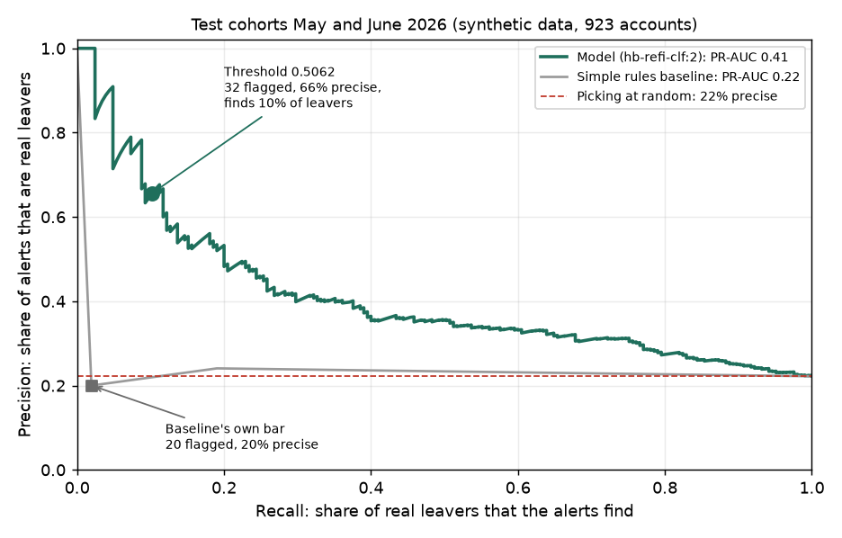

# Model evaluation results

**Synthetic data only.** HomeBridge is a fictional lender. These figures show that the workflow works. They do not show real predictive power or better retention.

Release `hb-refi-clf:2` (logistic regression), threshold **0.5062** (rule `min_precision` 0.6, see `docs/alert-threshold.md`). Measured on 10 November 2026. The same figures are in the evaluation report that notebook 05 wrote in Fabric (`Files/hb/output/reports/evaluation_report.json`, release `REL-20261110T121639Z`). A local rebuild with the same data and seed gives identical numbers.

## What the data is

- **Test data:** the refinancing cohorts of May and June 2026. 923 accounts. 205 of them (22.2%) left. The model never saw these accounts when it trained. The threshold was fixed on April 2026 data (the validation cohort, 460 accounts, 99 leavers).
- **Live-style run:** 303 open accounts scored on 16 October 2026. They have no outcome yet, so only the number of flagged accounts can be counted.

## Results on the test data

| | Model at 0.5062 | Simple rules baseline at its own bar (0.5) |
| --- | --- | --- |
| Accounts flagged | **32** of 923 | 20 of 923 |
| Real leavers among them | 21 | 4 |
| Precision | **65.6%** | 20.0% |
| Recall | **10.2%** | 2.0% |
| F1 | 0.177 | 0.036 |
| PR-AUC (average precision) | **0.409** | 0.225 |
| ROC AUC | 0.672 | 0.509 |

On the validation data the model at 0.5062 flags 16 of 460 accounts: 10 are real leavers, so precision is 62.5% and recall 10.1%.

On the 303 open accounts of the live-style run, **27 are flagged** at 0.5062 (ranks 1 to 27 in the review queue).

## What each figure means

- **Flagged:** accounts with a score at or above the threshold. Each one gets a review case.
- **Precision:** of the flagged accounts, the share that really left. 65.6% means about two in three alerts were right. Picking accounts at random would be right 22.2% of the time, so the alerts are about three times better than random.
- **Recall:** of all the real leavers, the share that the alerts found. 10.2% means the strict threshold finds about one leaver in ten. It is a choice for adviser time, not a claim that the others do not matter. A lower threshold finds more: at 0.1982 (best balance) the model flags 405 accounts, with precision 32% and recall 64%.
- **F1:** one number that mixes precision and recall (1 is perfect). It is low here because recall is low.
- **PR-AUC (average precision):** how well the score ranks leavers above stayers across all thresholds, with the base rate as the floor (0.222 here). 0.409 against 0.225 for the baseline means the model ranks leavers clearly better.
- **ROC AUC:** the chance that a random leaver scores above a random stayer (0.5 is a coin flip). The model is 0.672, the baseline 0.509.
- **Simple rules baseline:** a rule that uses only product-transfer request friction. It gives only three different scores, so it flags nobody at 0.5062. It is shown at its own bar, 0.5.

## How far to trust the numbers

- The strict threshold rests on few alerts. Precision 65.6% is 21 of 32. A 95% range is roughly 48% to 80%. Recall 10.2% is 21 of 205, roughly 7% to 15%.
- The synthetic data has a mild signal. Do not read these figures as what a real lender would see.
- Regenerate the figures with `python -m models_eval evaluate` (report in `data/output/reports/evaluation_report.md`). The chart comes from the same release.
